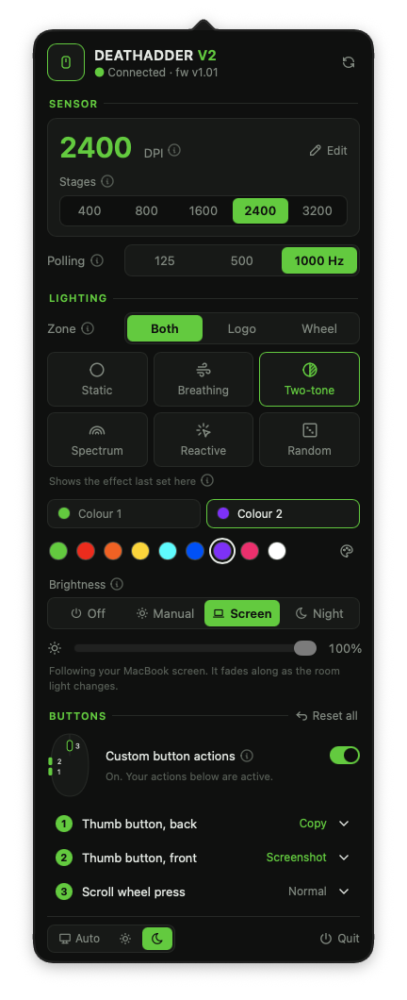
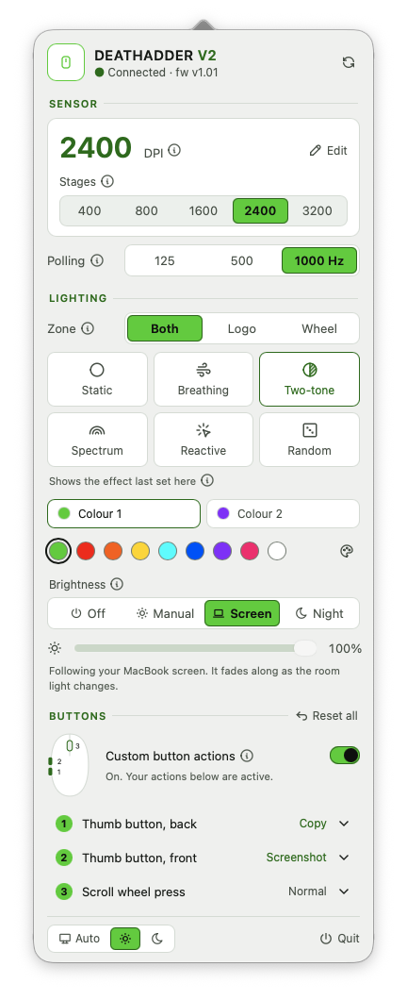
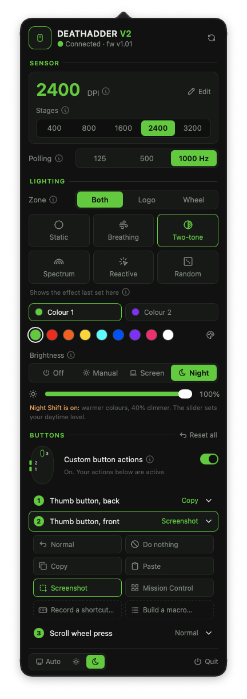
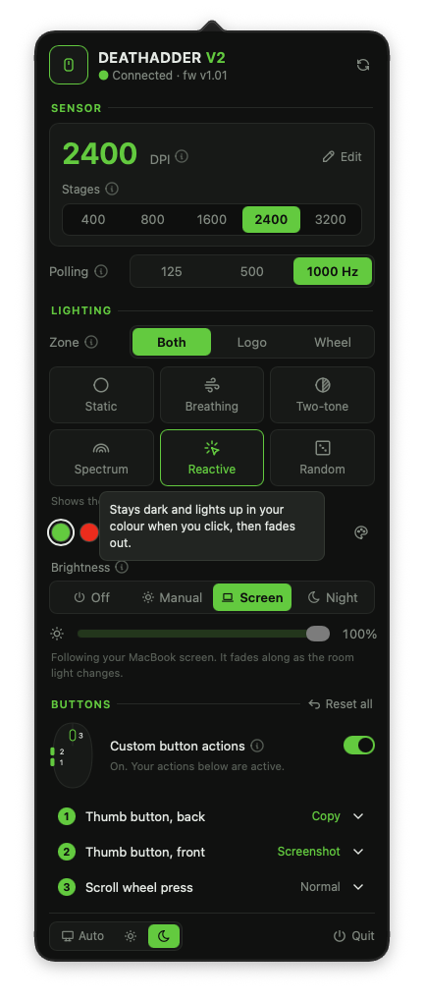

# DeathAdder V2 for Mac

A small menu bar app for the **Razer DeathAdder V2** (USB `1532:0084`) on macOS, with no Razer Synapse needed.
Click the icon in the menu bar and every setting is in one popover.

<p align="center">
  
  &nbsp;&nbsp;
  
</p>

## Features

### Sensor
- **DPI:** shown big, and you can click the number to type any value from 100 to 20000.
- **DPI stages:** the 1–5 presets that the button under the scroll wheel cycles through. Click one to switch to it, or
  use **Edit** to change how many there are and their values.
- **Stays in sync:** if you press the DPI button on the mouse, the app (and the DPI number in the menu bar) updates
  within a second.
- **Polling rate:** 125, 500 or 1000 Hz.

### Lighting
- **Zones:** change the logo, the scroll wheel or both together.
- **Effects:** Static, Breathing, Two-tone (breathes between two colours), Spectrum, Reactive (lights up when you
  click) and Random. Hover over an effect to see what it does.
- **Colours:** 9 swatches plus a custom colour picker that previews live on the mouse. Two-tone gets a
  **Colour 1 / Colour 2** switch. Effects that pick their own colours hide the swatches.
- **Brightness modes**, pick one:
  - **Off:** LEDs dark. Your colours and effect are kept.
  - **Manual:** set the level with a slider.
  - **Screen:** follows your MacBook screen's brightness, which macOS adjusts to the room light. It fades smoothly
    instead of jumping and is tuned so the steps look even to the eye.
  - **Night:** your own level during the day. While Night Shift warms your screen, the colours shift to a soft amber
    and the LEDs dim by 40%, then go back when Night Shift ends.

### Buttons and macros
- **Remap the extra buttons:** the two thumb buttons and the scroll wheel click.
- **Quick picks:** Normal, Do nothing, Copy, Paste, Screenshot and Mission Control.
- **Record a shortcut:** press any key combination to assign it.
- **Build a macro:** steps such as `cmd+c; wait 150; cmd+v` or `text hello`.
- **One switch for all of it:** picking an action turns it on. The first time, macOS asks for Accessibility
  permission, and remapping starts by itself once you allow it.
- Left click, right click and the DPI button aren't remappable.

<p align="center">
  
  &nbsp;&nbsp;
  
</p>

### Everything else
- **Light and dark themes:** Auto (follows macOS), Light or Dark, chosen at the bottom of the popover.
- **Hover help:** the ⓘ icons explain the advanced settings in plain words.
- **Accessible:** text meets WCAG AA contrast in both themes. Every control has a VoiceOver name and announces when
  it's selected, click targets are at least 24 points, and the app respects "Reduce motion".
- **Clear errors:** if macOS blocks the mouse, the popover says so, and clicking the message opens the right
  System Settings page.
- **Remembers everything:** settings are saved, and the menu bar shows the current DPI.
- **Command-line tool:** `python razer_da_v2.py status | dpi 1600 | color 00ff88 | poll 1000 …`

The mouse commands come from the open-source [OpenRazer](https://github.com/openrazer/openrazer) Linux driver, where
they're enabled for this exact model.

## Requirements

- macOS on Apple Silicon or Intel, with Python 3 (tested with Python 3.15 on macOS 27)
- A Razer DeathAdder V2 connected over USB

## Run it

```bash
python3 -m venv .venv
.venv/bin/pip install hidapi pyobjc-framework-Cocoa pyobjc-framework-Quartz pyobjc-framework-WebKit py2app
.venv/bin/python app.py
```

macOS asks for **Input Monitoring** permission (to talk to the mouse) and, if you turn on custom button actions,
**Accessibility** permission (to remap buttons).

## Build the .app

```bash
./make_signing_cert.sh   # once: a local code-signing certificate, so permissions survive rebuilds
./build.sh               # builds, signs, installs to /Applications and starts it
```

Without the certificate, every rebuild looks like a new app to macOS, and you'd have to grant the permissions again.
Only run one `./build.sh` at a time.

## Logo

The repo has no logo, so the app shows a mouse symbol. If you want your own, put a `logo.png` (a single-colour
shape on a transparent background) and an optional `icon.icns` next to `app.py` before building. The popover tints
the logo with your current LED colour.

## Files

| File | What it does |
|---|---|
| `app.py` | Menu bar app: status item, popover, mouse state, settings |
| `ui.html` | The popover's interface (runs in a WKWebView) |
| `razer_da_v2.py` | Talks to the mouse over USB HID; also the command-line tool |
| `remap.py` | Button remapping and macros (event tap) |
| `ambient.py` | Reads the Mac's screen brightness and Night Shift state |
| `build.sh`, `make_signing_cert.sh`, `setup.py` | Building and signing the .app |

Settings are saved in `~/Library/Application Support/RazerDAV2/config.json`.

## Notes

- The mouse can't report which lighting effect it's running, so the app shows the one it last set.
- Screen brightness follows the MacBook's built-in screen only. External monitors don't report their brightness.
- Screen brightness and Night Shift are read through private macOS frameworks, so a future macOS update could break
  them. If it does, those modes stop changing anything, but the rest of the app keeps working.

Not affiliated with or endorsed by Razer Inc. "Razer" and "DeathAdder" are trademarks of Razer Inc.

License: MIT (see `LICENSE`). The icons in `ui.html` are from [Tabler Icons](https://tabler.io/icons),
© 2020-2024 Paweł Kuna, also MIT.
